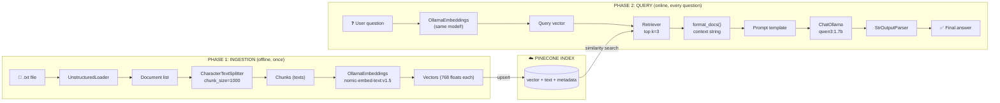
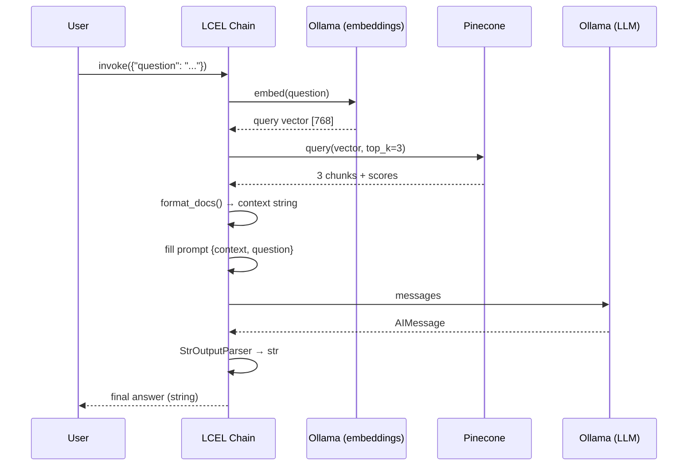
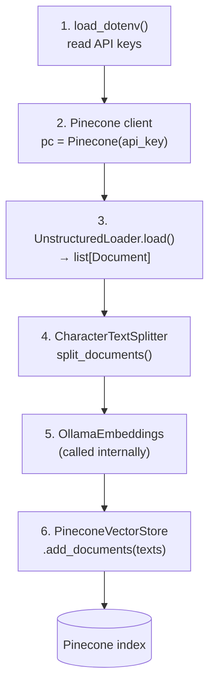

# 🧠 RAG Pipeline: LangChain + Ollama + Pinecone

> A revision guide for a **Retrieval-Augmented Generation (RAG)** project.
> Everything runs with a **local LLM** (Ollama) and a **cloud vector DB** (Pinecone).

---

## 📑 Table of Contents

1. [What is this project?](#1-what-is-this-project)
2. [Big picture architecture](#2-big-picture-architecture)
3. [Tech stack & roles](#3-tech-stack--roles)
4. [Setup](#4-setup)
5. [Phase 1: Ingestion (behind the scenes)](#5-phase-1--ingestion-behind-the-scenes)
6. [Phase 2: Retrieval & generation (behind the scenes)](#6-phase-2--retrieval--generation-behind-the-scenes)
7. [LCEL vs. manual chain](#7-lcel-vs-manual-chain)
8. [Core concepts cheat sheet](#8-core-concepts-cheat-sheet)
9. [Gotchas & bugs to remember](#9-gotchas--bugs-to-remember)
10. [Improvement ideas](#10-improvement-ideas)
11. [Glossary](#11-glossary)

---

## 1. What is this project?

An LLM only knows what it saw during training. It **cannot** know the content of *your* documents.
**RAG** fixes this in two steps:

1. **Retrieve**: find the pieces of your documents that are relevant to the question.
2. **Generate**: give those pieces to the LLM as context and ask it to answer *only* from them.

```
Question ──► find relevant chunks ──► stuff them in the prompt ──► LLM answers
```

The project has **two scripts**:

| Script | Role | Runs |
|---|---|---|
| `ingestion.py` | Reads a text file, cuts it into chunks, embeds them, stores them in Pinecone | Once (or when docs change) |
| `main.py` | Takes a question, retrieves top-3 chunks, asks the LLM | Every time you ask something |

---

## 2. Big picture architecture

### 2.1 Global view (both phases)



### 2.2 Same thing in ASCII (works everywhere)

```
╔══════════════════════ PHASE 1: INGESTION ═══════════════════════╗
║                                                                 ║
║  file.txt ─► UnstructuredLoader ─► [Document]                   ║
║                                        │                        ║
║                                        ▼                        ║
║                              CharacterTextSplitter              ║
║                              (1000 chars, overlap 0)            ║
║                                        │                        ║
║                                        ▼                        ║
║                                  [chunk, chunk, ...]            ║
║                                        │                        ║
║                                        ▼                        ║
║                       OllamaEmbeddings (nomic-embed-text)       ║
║                                        │                        ║
║                                        ▼                        ║
║                              [0.12, -0.8, ... ×768]             ║
╚════════════════════════════════════════│════════════════════════╝
                                         │ add_documents()
                                         ▼
                         ┌──────────────────────────────┐
                         │      PINECONE INDEX          │
                         │  id │ vector │ text │ meta   │
                         └──────────────────────────────┘
                                         ▲
                                         │ similarity search (top 3)
╔════════════════════════════════════════│════════════════════════╗
║                                        │                        ║
║  question ─► embed ─► query vector ────┘                        ║
║                                        │                        ║
║                                        ▼                        ║
║                              3 most similar chunks              ║
║                                        │                        ║
║                                        ▼                        ║
║                       format_docs → "chunk1\n\nchunk2\n\nchunk3" ║
║                                        │                        ║
║                                        ▼                        ║
║          Prompt: "Answer based only on {context}  Q: {question}"║
║                                        │                        ║
║                                        ▼                        ║
║                              ChatOllama (qwen3:1.7b)            ║
║                                        │                        ║
║                                        ▼                        ║
║                                  final answer                   ║
╚═════════════════════ PHASE 2: RETRIEVAL + GENERATION ═══════════╝
```

### 2.3 Sequence diagram (who talks to whom)



---

## 3. Tech stack & roles

| Component | Library / Tool | Role |
|---|---|---|
| Loader | `langchain_unstructured.UnstructuredLoader` | Reads the file and turns it into `Document` objects |
| Splitter | `CharacterTextSplitter` | Cuts big documents into small chunks |
| Embedding model | `OllamaEmbeddings` → `nomic-embed-text:v1.5` | Text → vector (768 dimensions) |
| Vector DB | Pinecone (`PineconeVectorStore`) | Stores vectors, does similarity search |
| LLM | `ChatOllama` → `qwen3:1.7b` | Writes the final answer (runs locally) |
| Orchestration | LangChain + **LCEL** | Connects every step into a chain |
| Config | `python-dotenv` | Loads secrets from `.env` |

---

## 4. Setup

### 4.1 Install

```bash
pip install python-dotenv pinecone langchain-core langchain-text-splitters \
            langchain-unstructured langchain-ollama langchain-pinecone
```

### 4.2 Pull the local models

```bash
ollama pull nomic-embed-text:v1.5
ollama pull qwen3:1.7b
```

### 4.3 `.env` file

```env
PINECONE_API_KEY=your_key_here
INDEX_NAME=your-index-name
```

### 4.4 Create the Pinecone index (important!)

| Setting | Value | Why |
|---|---|---|
| Dimension | **768** | Must equal the embedding model output size |
| Metric | `cosine` | Standard for text embeddings |

> ⚠️ If the dimension doesn't match the model, upserts fail.
> ⚠️ Use the **same embedding model** for ingestion and querying. Otherwise the vectors live in different "spaces" and the search returns garbage.

### 4.5 Run

```bash
python ingestion.py   # once
python main.py        # ask questions
```

### 4.6 Suggested structure

```
project/
├── .env
├── ingestion.py
├── main.py
├── 1_AI_Agents_and_Agentic_Workflows.txt
└── README.md
```

---

## 5. Phase 1: Ingestion (behind the scenes)

### 5.1 Step by step



### 5.2 What each step really does

**① Loader: `UnstructuredLoader`**
Reads the file and returns a list of `Document`:

```python
Document(
    page_content="...the text...",
    metadata={"source": "./file.txt", "filename": "file.txt", ...}
)
```

Parameters used:
- `chunking_strategy="basic"`: Unstructured itself groups elements into chunks.
- `max_characters=1000000000`: a huge limit so Unstructured doesn't split by itself (the real splitting is done next by LangChain).
- `encoding="utf-8"`: file encoding.

**② Splitter: `CharacterTextSplitter(chunk_size=1000, chunk_overlap=0)`**

```
Long text ──► split on "\n\n" (default separator)
          ──► merge pieces until ~1000 characters
          ──► emit chunk
```

- `chunk_size=1000`: **max characters** per chunk (not tokens).
- `chunk_overlap=0`: no shared text between neighbouring chunks.
- Default separator is `"\n\n"`. If a paragraph is bigger than 1000 characters it is **kept whole** (this splitter doesn't force-cut inside a paragraph).

```
WITHOUT overlap (current)         WITH overlap (e.g. 200)
┌──────────┐                      ┌──────────┐
│ chunk 1  │                      │ chunk 1  │
└──────────┘                      └──────┬───┘
┌──────────┐                      ┌──────┴───┐   ← shared zone keeps
│ chunk 2  │                      │ chunk 2  │     context across the cut
└──────────┘                      └──────────┘
```

**③ Embeddings: `OllamaEmbeddings(model="nomic-embed-text:v1.5")`**
Each chunk goes to the local Ollama server, which returns a **vector of 768 numbers**.
Similar meaning → vectors that are close in space.

```
"LangGraph handles cycles"        → [0.21, -0.43, 0.88, ... ]
"LangGraph supports loops"        → [0.20, -0.41, 0.90, ... ]   ← very close
"Pizza recipe with mozzarella"    → [-0.7,  0.12, -0.3, ... ]   ← far away
```

**④ Vector store: `PineconeVectorStore.add_documents`**
For each chunk Pinecone stores one **record**:

| Field | Content |
|---|---|
| `id` | Random UUID (auto-generated) |
| `values` | The 768-float vector |
| `metadata` | `text` (the chunk itself) + the original metadata (`source`, ...) |

> 💡 Pinecone stores vectors, **and LangChain also stores the chunk text in metadata**. That's how the retriever can give you back the readable text, not just numbers.

---

## 6. Phase 2: Retrieval & generation (behind the scenes)

### 6.1 The retriever

```python
vector_store = PineconeVectorStore(index_name=..., embedding=embeddings)
retriever = vector_store.as_retriever(search_kwargs={"k": 3})
```

When you call `retriever.invoke("question")`:

```
"question" ─► embed ─► [768 floats] ─► Pinecone cosine search ─► top 3 Documents
```

```
                      Vector space (2D simplified)

           ● chunk A                      ★ = your question
                    ● chunk B (✔ top 3)
              ★     ● chunk C (✔ top 3)  
        ● chunk D (✔ top 3)
                                    ● chunk E
              ● chunk F                         ← too far, ignored
```

**Cosine similarity**: measures the *angle* between two vectors.
`1.0` = same direction (same meaning), `0` = unrelated, `-1` = opposite.

### 6.2 The prompt template

```python
ChatPromptTemplate.from_template("""
Answer the question based only on the following context :
{context}
Question : {question}
Provide a detailed answer :
""")
```

- `{context}` ← the 3 chunks joined together
- `{question}` ← the user question
- "based **only** on the context" → reduces hallucinations.

### 6.3 `format_docs`

```python
def format_docs(docs):
    return "\n\n".join(doc.page_content for doc in docs)
```

```
[Document1, Document2, Document3]
            ↓
"text of doc 1

text of doc 2

text of doc 3"
```

### 6.4 The LLM + `temperature=0`

`temperature=0` → (almost) deterministic output, the model picks the most probable token each time. Good for factual RAG answers.

---

## 7. LCEL vs. manual chain

**LCEL** = *LangChain Expression Language*. The `|` operator pipes the output of one component into the next, like Unix pipes.

### 7.1 Manual version (`retreival_chain_without_lcel`)

```
query ──► retriever.invoke ──► format_docs ──► prompt.format_messages ──► llm.invoke ──► .content
          (you call each step yourself, one by one)
```

### 7.2 LCEL version (`retreival_chain_with_lcel`)

```python
chain = (
    RunnablePassthrough.assign(
        context = itemgetter("question") | retriever | format_docs
    )
    | prompt_template
    | llm
    | StrOutputParser()
)
```

### 7.3 Data flow, shape at each stage 🔍

This is the part to really understand:

```
INPUT
  {"question": "Why might LangGraph be preferable?"}
        │
        ▼
┌─────────────────────────────────────────────────────────────┐
│ RunnablePassthrough.assign(context = ...)                   │
│                                                             │
│   keeps the original dict AND adds a new key "context":     │
│                                                             │
│   itemgetter("question")  → "Why might LangGraph..."  (str) │
│        │                                                    │
│        ▼                                                    │
│   retriever               → [Doc, Doc, Doc]      (list)     │
│        │                                                    │
│        ▼                                                    │
│   format_docs             → "chunk1\n\nchunk2..." (str)     │
└─────────────────────────────────────────────────────────────┘
        │
        ▼
  {"question": "...", "context": "chunk1\n\nchunk2\n\nchunk3"}
        │
        ▼
┌───────────────────┐
│  prompt_template  │ → ChatPromptValue (formatted messages)
└───────────────────┘
        │
        ▼
┌───────────────────┐
│       llm         │ → AIMessage(content="...answer...")
└───────────────────┘
        │
        ▼
┌───────────────────┐
│ StrOutputParser   │ → "…answer…"   (plain str)
└───────────────────┘
        │
        ▼
OUTPUT (str)
```

### 7.4 Key building blocks

| Piece | What it does |
|---|---|
| `Runnable` | Base interface: anything with `.invoke()`, `.stream()`, `.batch()`, `.ainvoke()` |
| `\|` | Composes two runnables into a `RunnableSequence` |
| `itemgetter("question")` | Extracts `dict["question"]`. Python functions are auto-wrapped as runnables |
| `RunnablePassthrough.assign(k=...)` | Passes the input dict through **and** adds a computed key |
| `retriever` | It's a Runnable too: `str → list[Document]` |
| `StrOutputParser` | `AIMessage → str` |

### 7.5 Comparison

| Feature | Manual | LCEL |
|---|---|---|
| Code length | Longer | Shorter |
| Streaming (`.stream()`) | ❌ must code it | ✅ built-in |
| Async (`.ainvoke()`) | ❌ must code it | ✅ built-in |
| Batch (`.batch([...])`) | ❌ | ✅ |
| Composable / reusable | Hard | Easy |
| Tracing (LangSmith) | Partial | Automatic per step |
| Readability for debugging steps | Very explicit | Need to know the model |

### 7.6 Free features of LCEL

```python
chain.invoke({"question": "..."})                 # one answer
for tok in chain.stream({"question": "..."}):     # token by token
    print(tok, end="")
chain.batch([{"question": "a"}, {"question": "b"}])   # many in parallel
await chain.ainvoke({"question": "..."})          # async
```

---

## 8. Core concepts cheat sheet

| Concept | One-line explanation |
|---|---|
| **RAG** | Retrieve relevant text, then let the LLM answer using it |
| **Embedding** | A vector (list of floats) representing the *meaning* of a text |
| **Vector DB** | Database optimised for "find the nearest vectors" |
| **Chunk** | A small piece of a document (embedding a whole book would blur its meaning) |
| **chunk_size** | Max size of a chunk (in characters here) |
| **chunk_overlap** | Characters shared between consecutive chunks |
| **top-k (k=3)** | Number of chunks returned by the search |
| **Cosine similarity** | Angle-based closeness of two vectors |
| **Context window** | Max text the LLM can read at once (limits how many chunks you can send) |
| **Hallucination** | LLM inventing facts; reduced by "answer only from context" |
| **Temperature** | Randomness of LLM output (0 = deterministic) |
| **LCEL** | Pipe syntax to compose LangChain components |

### Chunk size trade-off

```
Small chunks (200)            Big chunks (2000)
✔ precise retrieval           ✔ more context per chunk
✘ may lose context            ✘ noisy, diluted meaning
✘ more vectors to store       ✘ fills the LLM context quickly
```

### k trade-off

```
k small (1-2)                 k big (8-10)
✔ focused, cheap              ✔ higher chance to contain the answer
✘ may miss the answer         ✘ more noise, slower, may confuse small LLMs
```

---

## 9. Gotchas & bugs to remember

1. **Embedding model must be the same** at ingestion and at query time.
2. **Index dimension = model dimension** (768 for `nomic-embed-text:v1.5`).
3. **Re-running `ingestion.py` duplicates data.** IDs are random, so the same chunks get stored again. Fix: pass deterministic IDs, e.g. a hash of the chunk, via `add_documents(texts, ids=[...])`, or clear the index first.
4. **Double chunking.** `UnstructuredLoader(chunking_strategy="basic")` *and* `CharacterTextSplitter` both chunk. It works (huge `max_characters` neutralises the first), but you could simplify by removing the loader's chunking.
5. **`nomic-embed-text` prefixes.** The model is trained to work best with task prefixes: `search_document: <text>` when indexing and `search_query: <question>` when querying. Plain `OllamaEmbeddings` doesn't add them automatically, so retrieval may be slightly weaker without them.
6. **Docstring typo in the code.** The LCEL docstring says `{"questions": ...}` but the real key is **`"question"`** (singular). The wrong key gives a `KeyError`.
7. **Spelling:** `retreiver` / `retreival` should be `retriever` / `retrieval` (works, but harder to read and search).
8. **Qwen3 "thinking".** Qwen3 models can output their reasoning (`<think>...</think>`) before the answer. If you see this, strip it or disable thinking mode in your Ollama / `ChatOllama` settings (depends on the version).
9. **Small model (1.7B).** It may ignore instructions or answer poorly with long contexts. If answers are weak, first check *retrieved chunks*, then try a bigger model.
10. **Debug tip.** Always print what the retriever returns before blaming the LLM:

```python
for d in retriever.invoke("your question"):
    print(d.metadata, "\n", d.page_content[:200], "\n---")
```

---

## 10. Improvement ideas

| Idea | Benefit |
|---|---|
| `RecursiveCharacterTextSplitter` + `chunk_overlap=100-200` | Better splits (paragraph → sentence → word) and no lost context |
| Deterministic IDs | No duplicates on re-ingestion |
| Return sources (`RunnableParallel`) | Show which chunks produced the answer |
| `search_type="mmr"` in retriever | Less redundant chunks |
| Score threshold | Ignore irrelevant chunks |
| Reranker | Re-order the top 10 and keep the best 3 |
| Chat history | Conversational RAG with follow-up questions |
| Evaluation (RAGAS, LangSmith) | Measure answer quality objectively |
| LangGraph | Multi-step / agentic RAG (retry, route, self-correct) |

Example: returning sources with LCEL

```python
from langchain_core.runnables import RunnableParallel

chain = (
    RunnableParallel(
        context=itemgetter("question") | retriever,   # keep raw docs
        question=itemgetter("question"),
    )
    | RunnablePassthrough.assign(
        answer=(
            RunnablePassthrough.assign(context=lambda x: format_docs(x["context"]))
            | prompt_template | llm | StrOutputParser()
        )
    )
)
# → {"context": [Docs], "question": "...", "answer": "..."}
```

---

## 11. Glossary

- **Document**: LangChain object with `page_content` (text) and `metadata` (dict).
- **Runnable**: any LangChain component that can be invoked/streamed/batched.
- **Retriever**: a Runnable that turns a query string into a list of Documents.
- **Vector store**: wrapper around a vector DB (here Pinecone) to add and search vectors.
- **Upsert**: insert a record, or update it if the ID already exists.
- **Serverless (Pinecone)**: managed index type where you don't handle infrastructure.
- **Ollama**: tool to run LLMs and embedding models locally.
- **Token**: sub-word unit processed by LLMs (not the same as a character).

---

### ✅ 30-second recap

```
INGEST : file → load → split → embed → store in Pinecone
ASK    : question → embed → top-3 chunks → prompt → LLM → answer
LCEL   : dict in → assign(context) → prompt → llm → parser → str out
```