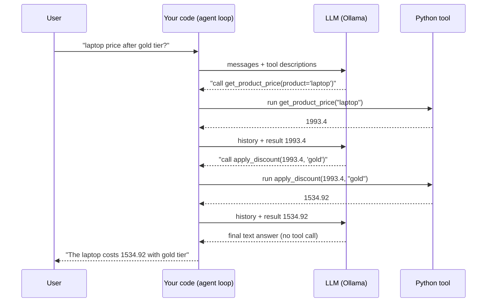

# Agents From Scratch: ReAct → Native Tool Calling → LangChain

A learning project that builds the **same tiny shopping agent three times**, each time handing a bit more work to a framework, so you can see exactly what LangChain (`@tool`, `bind_tools`, `ToolMessage`...) is doing behind the scenes.

> **The agent's job:** answer *"what's the laptop price after applying the gold tier?"* by calling two Python tools:
> `get_product_price("laptop")` → `1993.4`, then `apply_discount(1993.4, "gold")` → `1534.92`.

**Core idea to remember forever:**

> An LLM can only **produce text**. It never runs your code.
> "Tool calling" = the LLM writes *"please run function X with args Y"* as text/JSON → **your code** runs it → you feed the result back → the LLM continues.
> Every framework is just automation of that loop.

---

## Table of contents

1. [Project layout and setup](#1-project-layout-and-setup)
2. [The universal agent loop](#2-the-universal-agent-loop)
3. [Version 1: manual ReAct (prompt + regex)](#3-version-1-manual-react-prompt--regex)
4. [Version 2: native tool calling with the Ollama SDK](#4-version-2-native-tool-calling-with-the-ollama-sdk)
5. [Version 3: LangChain](#5-version-3-langchain)
6. [What `@tool` does behind the scenes](#6-what-tool-does-behind-the-scenes)
7. [What `bind_tools` does behind the scenes](#7-what-bind_tools-does-behind-the-scenes)
8. [How function calling really works inside the model](#8-how-function-calling-really-works-inside-the-model)
9. [Messages: the conversation is the memory](#9-messages-the-conversation-is-the-memory)
10. [Full trace of one run](#10-full-trace-of-one-run)
11. [Side-by-side comparison](#11-side-by-side-comparison)
12. [LangSmith tracing (`@traceable`)](#12-langsmith-tracing-traceable)
13. [Known gotchas and bugs in the current code](#13-known-gotchas-and-bugs-in-the-current-code)
14. [What `create_agent` replaces](#14-what-create_agent-replaces)
15. [Cheat sheet / glossary](#15-cheat-sheet--glossary)
16. [Revision exercises](#16-revision-exercises)

---

## 1. Project layout and setup

Rename to whatever you like, these are the names used in this README:

| File | What it is |
|---|---|
| `react_agent.py` | **Version 1**: manual ReAct. No tool-calling API, only prompt text + regex parsing |
| `ollama_tool_calling.py` | **Version 2**: native tool calling via the `ollama` SDK, JSON schemas written by hand |
| `langchain_agent.py` | **Version 3**: LangChain (`@tool`, `init_chat_model`, `bind_tools`, message classes) |

### Setup

```bash
# 1. Model
ollama pull qwen3:1.7b

# 2. Python deps
pip install ollama langchain langchain-ollama langsmith python-dotenv
```

`.env` (loaded by `load_dotenv()`), only needed for LangSmith tracing:

```env
LANGSMITH_TRACING=true
LANGSMITH_API_KEY=your_key_here
LANGSMITH_PROJECT=agent-from-scratch
```

> `init_chat_model("ollama:qwen3:1.7b")` needs the **`langchain-ollama`** package installed. The `ollama:` prefix tells LangChain which provider integration to load.

---

## 2. The universal agent loop

All three versions are this loop. Only *who writes the prompt* and *who parses the answer* changes.



Pseudo-code (memorize this):

```python
messages = [system_prompt, user_question]
for i in range(MAX_ITERATIONS):          # safety net against infinite loops
    reply = llm(messages, tools)         # 1. ask the model
    if no tool requested in reply:       # 2. model is done
        return reply.text
    result = run_tool(reply.tool_call)   # 3. YOU execute the function
    messages += [reply, result]          # 4. append both, then loop
```

Why `MAX_ITERATIONS`? A small model can loop forever (calling the same tool again and again). The cap guarantees termination.

---

## 3. Version 1: manual ReAct (prompt + regex)

**ReAct = Reason + Act.** No special API. We *teach the format in the prompt* and parse the text ourselves.

### 3.1 Building the tool list for the prompt

```python
def get_tool_description(tools_dict):
    for tool_name, tool_function in tools_dict.items():
        original_function = getattr(tool_function, "__wrapped__", tool_function)
        signature = inspect.signature(original_function)
        docstring = inspect.getdoc(original_function) or ""
        descriptions.append(f"{tool_name}{signature} - {docstring}")
```

Produces text like:

```
get_product_price(product: str) -> float - look up the price of the product in the catalog
apply_discount(price: float, discount_tier: str) -> float - applying discount based on ...
```

- `inspect.signature` reads the **type hints**; `inspect.getdoc` reads the **docstring**.
- `__wrapped__`: `@traceable` wraps your function in another function; `functools.wraps` stores the original in `__wrapped__`. We unwrap to get the *real* signature (otherwise you would see `(*args, **kwargs)`).
- **Remember this:** type hints + docstring = everything the model knows about a tool. LangChain's `@tool` does the same trick but outputs JSON schema instead of plain text (see section 6).

### 3.2 The ReAct prompt

```
Question: ...
Thought: I need the laptop price
Action: get_product_price
Action Input: laptop
Observation: 1993.4          <- written by YOUR CODE, not the model
Thought: now apply discount
Action: apply_discount
Action Input: 1993.4 , gold
Observation: 1534.92
Thought: I now know the final answer
Final Answer: 1534.92
```

The prompt **ends with `Thought`** to *prime* the model to continue by reasoning. The scratchpad also ends with `\nThought` for the same reason.

### 3.3 The two critical settings

```python
options={"stop": ["\nObservation"], "temperature": 0}
```

- **`stop=["\nObservation"]`** is the key trick. Without it, the model would continue the pattern and **hallucinate the observation** (invent a price). With it, generation halts right before `Observation`, so *we* run the real tool and write the real observation.
- **`temperature=0`** gives deterministic output, which matters because we parse with regex.

### 3.4 Parsing the output

```python
re.search(r"Final Answer: \s*(.+)", output)   # done?
re.search(r"Action: \s*(.+)", output)         # which tool?
re.search(r"Action Input: \s*(.+)", output)   # which args?
```

Then:

```python
raw_args = [x.strip() for x in tool_input_raw.split(" , ")]
args = [x.split("=", 1)[-1].strip().strip("'\'") for x in raw_args]
observation = str(tools[tool_name](*args))
```

- Everything arrives as **strings**, which is why `apply_discount` does `price = float(price)`. In Versions 2 and 3 the arguments arrive already typed from JSON.
- Args are passed **positionally** (`*args`), so order matters.

### 3.5 The scratchpad

```python
scratchpad = f"{output}\nObservation : {observation}\nThought"
full_prompt = prompt + scratchpad
```

The scratchpad is the "memory": each iteration re-sends the **whole prompt + everything that happened so far** as one big string. (See gotcha #1: it should accumulate with `+=`.)

### 3.6 Pros and cons

| ✅ Pros | ❌ Cons |
|---|---|
| Works with **any** model, even ones without tool support | Fragile regex parsing |
| Shows exactly what is going on | Model can break the format |
| No framework needed | Args are untyped strings |

---

## 4. Version 2: native tool calling with the Ollama SDK

Now the model is *trained/templated* for tool calling, so we stop doing prompt-format + regex. We send **JSON schemas** and get **structured tool calls** back.

### 4.1 The tool schema (hand-written)

```python
tools_for_llm = [{
    "type": "function",
    "function": {
        "name": "get_product_price",
        "description": "a tool to look up the price of the product in the catalog",
        "parameters": {
            "type": "object",
            "required": ["product"],
            "properties": {
                "product": {"type": "string", "description": "..."}
            }
        }
    }
}, ...]
```

This is the **OpenAI-style function schema**, now the de-facto standard (Ollama, OpenAI, and LangChain's internal format all use it). Anatomy:

- `name`: what the model will write back when it wants this tool.
- `description`: the model's only clue about *when* to use it.
- `parameters`: a **JSON Schema** describing the arguments (names, types, required).

> ⚠️ In `apply_discount` the schema says `"type": "float"`. JSON Schema has no `float`, the correct type is `"number"`. It works with small models by luck; fix it (see gotchas).

### 4.2 The call

```python
response = chat(model=MODEL, tools=tools_for_llm, messages=messages)
ai_message = response.message
tool_calls = ai_message.tool_calls
```

The response when the model wants a tool (conceptually):

```json
{
  "message": {
    "role": "assistant",
    "content": "",
    "tool_calls": [
      { "function": { "name": "get_product_price", "arguments": { "product": "laptop" } } }
    ]
  }
}
```

- `tool_calls` empty/None → the model is giving a **final answer** (`content`).
- `arguments` is already a **dict** → `tool_to_use(**tool_call_args)` just works.
- **No `id`** on tool calls in Ollama (the code has a comment about that). OpenAI/Anthropic give each call an id and require the result to reference it.

### 4.3 Feeding the result back

```python
messages.append(ai_message)                                   # the assistant's tool request
messages.append({"role": "tool", "content": str(observation)})  # our result
```

Two things must go back, **in order**: (1) the assistant message that contains the tool call, (2) the `tool` message with the result. Skip (1) and the model sees a result for a call it never made.

> Tool results are always **strings** (`str(observation)`), since they are just message text.

---

## 5. Version 3: LangChain

Same loop, but LangChain supplies: schema generation (`@tool`), provider abstraction (`init_chat_model`), tool binding (`bind_tools`), and typed messages.

```python
@tool
def get_product_price(product: str) -> float:
    """look up the price of the product in the catalog"""

llm = init_chat_model("ollama:qwen3:1.7b", temperature=0)
llm_with_tools = llm.bind_tools([get_product_price, apply_discount])

ai_message = llm_with_tools.invoke(messages)
tool_call = ai_message.tool_calls[0]      # {"name": ..., "args": {...}, "id": ...}
observation = tools_dict[tool_call["name"]].invoke(tool_call["args"])
messages.append(ai_message)
messages.append(ToolMessage(content=str(observation), tool_call_id=tool_call["id"]))
```

Mapping from Version 2 to Version 3:

| Version 2 (raw Ollama) | Version 3 (LangChain) |
|---|---|
| Hand-written `tools_for_llm` JSON | `@tool` generates it from signature + docstring |
| `chat(model=..., tools=...)` | `llm.bind_tools(...).invoke(messages)` |
| `{"role": "system", ...}` dicts | `SystemMessage`, `HumanMessage`, `AIMessage`, `ToolMessage` |
| `tool_call.function.name` | `tool_call["name"]` |
| `tool_call.function.arguments` | `tool_call["args"]` |
| no ids | `tool_call["id"]` (LangChain generates one) → `ToolMessage(tool_call_id=...)` |
| `tools_dict[name](**args)` | `tools_dict[name].invoke(args)` |
| Locked to Ollama | Swap `"ollama:..."` for `"openai:gpt-4o"` or `"anthropic:..."`, nothing else changes |

---

## 6. What `@tool` does behind the scenes

`@tool` turns a plain function into a **`StructuredTool` object**. It is **not** a function anymore. That's why you call `.invoke(...)` on it.

```python
@tool
def get_product_price(product: str) -> float:
    """look up the price of the product in the catalog"""
```

LangChain inspects the function (the same idea as `get_tool_description` in Version 1, but richer):

| It reads... | ...and produces |
|---|---|
| function name | `tool.name` → `"get_product_price"` |
| **docstring** | `tool.description` → what the model reads to decide when to use it |
| **type hints** | `tool.args_schema`: a Pydantic model → JSON Schema (`product: str` → `{"type": "string"}`) |
| params without defaults | the `required` list |

You can inspect it yourself:

```python
print(get_product_price.name)         # get_product_price
print(get_product_price.description)  # look up the price of the product in the catalog
print(get_product_price.args)         # {'product': {'title': 'Product', 'type': 'string'}}

from langchain_core.utils.function_calling import convert_to_openai_tool
print(convert_to_openai_tool(get_product_price))
# {'type': 'function',
#  'function': {'name': 'get_product_price',
#               'description': 'look up the price of the product in the catalog',
#               'parameters': {'type': 'object',
#                              'properties': {'product': {'type': 'string'}},
#                              'required': ['product']}}}
```

**That output is the hand-written `tools_for_llm` from Version 2.** `@tool` is a code generator for that JSON.

What `.invoke(args_dict)` does:

1. **Validates** the args dict against the Pydantic schema (wrong type → error before your function runs; compatible types such as `"1993.4"` may be coerced).
2. Calls your original function.
3. Returns the result.

Practical consequences:

- ✍️ **Docstrings are prompts.** A vague docstring → the model picks the wrong tool. Write them for the *model*.
- ✍️ **Type hints are mandatory in practice.** No hints → poor schema.
- 🔧 Need the raw function? `get_product_price.func(...)`.
- 🔧 Tip: `tool.invoke(tool_call)` (the **whole** tool-call dict with `id`) returns a ready-made `ToolMessage`, so you can skip building it by hand.

---

## 7. What `bind_tools` does behind the scenes

```python
llm = init_chat_model("ollama:qwen3:1.7b", temperature=0)
llm_with_tools = llm.bind_tools(tools)
```

**`init_chat_model("ollama:qwen3:1.7b")`**: a factory. It splits the string into provider (`ollama`) + model (`qwen3:1.7b`) and returns the right class, here `ChatOllama` from `langchain-ollama`. `ChatOllama` internally uses the same `ollama` SDK from Version 2.

**`bind_tools(tools)`**:

1. Converts each tool to the OpenAI-style JSON schema (`convert_to_openai_tool`).
2. Returns a **new** runnable (a `RunnableBinding`) that automatically passes `tools=[...]` on **every** `.invoke()`.
3. Does **not** modify `llm`; `llm` itself still has no tools.

So `llm_with_tools.invoke(messages)` ≈ `ollama.chat(model=..., messages=..., tools=[...schemas...])`.

**What `.invoke(messages)` returns:** an `AIMessage`:

```python
AIMessage(
    content="",                      # empty when the model asks for a tool
    tool_calls=[{
        "name": "get_product_price",
        "args": {"product": "laptop"},
        "id": "…uuid…",              # generated by LangChain because Ollama has none
        "type": "tool_call",
    }],
    response_metadata={...},         # model name, timings, etc.
    usage_metadata={...},            # token counts
)
```

> Important: `bind_tools` **only tells the model which tools exist**. It never runs anything. Executing the tool is still your `tool.invoke(...)` in the loop. (`create_agent` automates this, see section 14.)

---

## 8. How function calling really works inside the model

There is no magic "function calling" module inside an LLM. It is **three ordinary things** stacked:

1. **Chat template injects the schemas into the prompt.** Ollama renders the model's chat template, which places your tool JSON in the system prompt, with instructions on how to request a call. For Qwen-style models this looks roughly like:

   ```
   You are provided with function signatures within <tools></tools> XML tags:
   <tools>
   {"type": "function", "function": {"name": "get_product_price", ...}}
   </tools>
   For each function call, return a json object within <tool_call></tool_call> tags:
   <tool_call>
   {"name": <function-name>, "arguments": <args-json-object>}
   </tool_call>
   ```

2. **The model was fine-tuned** on many examples of this format, so it reliably emits something like:

   ```
   <tool_call>
   {"name": "get_product_price", "arguments": {"product": "laptop"}}
   </tool_call>
   ```

3. **The runtime parses it.** Ollama detects the `<tool_call>` block, parses the JSON and returns it as a clean `tool_calls` field.

**So Version 1 and Version 2 are the same mechanism.** The only difference is who does the work:

| | Prompt with tool descriptions | Output format | Parsing |
|---|---|---|---|
| Version 1 (ReAct) | **You** write it | Free text `Action: ...` | **You** (regex) |
| Version 2/3 (native) | Chat template does it | JSON the model was trained on | **Ollama** |

Native tool calling is just **ReAct with a model-specific format, built-in prompt, and a robust parser**. That's also why small models (1.7B) can still fail: they may call the wrong tool, invent arguments, or skip the tool and answer from "memory". Your strict system-prompt rules exist to compensate for that.

---

## 9. Messages: the conversation is the memory

LLMs are **stateless**. Every call must resend the **entire history**. `messages` *is* the memory.

| LangChain class | Raw role | Who writes it | Purpose |
|---|---|---|---|
| `SystemMessage` | `system` | you | Rules/behavior |
| `HumanMessage` | `user` | the user | The question |
| `AIMessage` | `assistant` | the model | Answer **or** `tool_calls` |
| `ToolMessage` | `tool` | your code | Tool result (+ `tool_call_id`) |

Why `tool_call_id`? An `AIMessage` may request several calls at once. Each `ToolMessage` says *which* call it answers. OpenAI and Anthropic **reject** a conversation where a tool call has no matching result. Ollama doesn't use ids, so LangChain's generated ids are mostly cosmetic there, but writing it correctly keeps your code portable.

The system prompt in this project enforces the workflow:

1. Never guess prices → must call `get_product_price` first.
2. Only call `apply_discount` after receiving a real price, passing that exact number.
3. Never compute discounts yourself, always use the tool.
4. If no tier is given, **ask** the user.

Rule 4 is where the loop ends *without* a tool call: the model returns plain text (a question) and `if not tool_calls: return ...` fires.

---

## 10. Full trace of one run

Question: `"what's laptop price after appling gold tier ?"`

**Iteration 1**

```
messages = [System(rules), Human(question)]
model → AIMessage(tool_calls=[get_product_price(product="laptop")])
code  → runs tool → 1993.4
messages += [AIMessage(tool_call), ToolMessage("1993.4")]
```

**Iteration 2**

```
messages = [System, Human, AI(call #1), Tool("1993.4")]
model → AIMessage(tool_calls=[apply_discount(price=1993.4, discount_tier="gold")])
code  → 1993.4 - 1993.4 * 0.23 = 1534.918 → round(…, 2) = 1534.92
messages += [AIMessage(tool_call), ToolMessage("1534.92")]
```

**Iteration 3**

```
messages = [System, Human, AI(call #1), Tool, AI(call #2), Tool("1534.92")]
model → AIMessage(content="The laptop costs 1534.92 after the gold discount.", tool_calls=[])
no tool calls → print + return
```

The history grows every iteration and the model re-reads **all of it** each time.

---

## 11. Side-by-side comparison

| Aspect | V1: ReAct | V2: Ollama native | V3: LangChain |
|---|---|---|---|
| Tool description | Text built via `inspect` | Hand-written JSON | Auto from `@tool` |
| How model asks for a tool | `Action:` / `Action Input:` text | Structured `tool_calls` | Structured `tool_calls` |
| Parsing | Your regex | Ollama | Ollama + LangChain |
| Args type | Strings | Typed dict | Typed dict (validated) |
| Memory | One growing string (scratchpad) | List of dict messages | List of Message objects |
| Stops hallucinated results via | `stop=["\nObservation"]` | Native format | Native format |
| Run a tool | `tools[name](*args)` | `tools[name](**args)` | `tools[name].invoke(args)` |
| Model portability | Any model | Ollama only | Any provider |
| Robustness | Low | Medium | Medium to high |
| Lines of glue code | Most | Medium | Least |

---

## 12. LangSmith tracing (`@traceable`)

```python
@traceable(run_type="tool")                       # logs each tool run
@traceable(name="Ollama chat traced", run_type="llm")   # logs each LLM call
@traceable(name="Langchain agent loop")           # the parent run (whole loop)
```

- `load_dotenv()` loads `LANGSMITH_*` env vars so the decorator knows where to send traces.
- Nested traced calls appear as a **tree**: agent loop → LLM call → tool → LLM call → ...
- `run_type` (`tool`, `llm`, `chain`) controls how LangSmith displays it (token counts for `llm`, etc.).
- Version 3 gets LLM-level tracing automatically from LangChain when `LANGSMITH_TRACING=true`; `@traceable` on `run_agent` adds the **parent** span so everything nests under one run.
- Decorating wraps the function, which is why Version 1 needs `__wrapped__` to inspect the original signature.

---

## 13. Known gotchas and bugs in the current code

Worth fixing, and worth understanding, since they teach the concepts.

### V1 (ReAct)

1. **Scratchpad is overwritten, not accumulated.**
   ```python
   scratchpad = f"{output}\nObservation : {observation}\nThought"   # ❌ forgets earlier steps
   scratchpad += f"{output}\nObservation: {observation}\nThought"   # ✅
   ```
   With two tool calls the model loses the first observation (the price) on iteration 3. It "works" now only because the run finishes in 3 steps.
2. **Fragile arg splitting:** `split(" , ")` requires space-comma-space. If the model writes `1993.4, gold`, parsing breaks. Prefer `split(",")` + `strip()`.
3. **`strip("'\'")`** is the same as `strip("'")` (the `\'` is just an escaped quote). To strip both quote types use `strip("'\"")`.
4. Regexes `Action: \s*` expect a space after the colon; `Action:laptop` won't match. Use `r"Action:\s*(.+)"`.
5. `react_prompt.format(...)`: if a tool docstring ever contains `{` or `}` it will crash the `.format`.
6. `prices.get(product, 0)` returns `0` for an unknown product, and the agent may then happily apply a discount to `0`. Better to return an error string the model can react to.

### V2 (Ollama native)

1. **`"type": "float"` is not valid JSON Schema** → use `"number"`.
2. **Only `tool_calls[0]` is handled.** If the model emits two calls at once, the second is silently dropped. Fix: loop over all of them and append one tool message per call:
   ```python
   messages.append(ai_message)
   for call in tool_calls:
       result = tools_dict[call.function.name](**call.function.arguments)
       messages.append({"role": "tool", "tool_name": call.function.name, "content": str(result)})
   ```
   (`tool_name` is Ollama's way to link a result to a call, since there are no ids.)
3. **Wrong variable in the error message:** `raise ValueError(f"tool {tool_to_use} not found!")` prints `None`. It should print `tool_call_name`.
4. The system prompt is inside a `"""` string **with embedded quotes**, so those literal `"` characters are sent to the model. Harmless but noisy. Use plain concatenated strings (like V3) or a clean triple-quoted text.

### V3 (LangChain)

1. Same **`tool_calls[0]`** limitation and **wrong error variable** as V2.
2. Raising `ValueError` on an unknown tool kills the run. Often better to return a `ToolMessage("Error: unknown tool")` and let the model recover.
3. `price: float` is validated by Pydantic, so if a small model passes `"1993.4"` it will be coerced, but garbage like `"about 2000"` raises a validation error. Catching exceptions around `.invoke()` and sending the error text back as a `ToolMessage` lets the model self-correct.
4. `qwen3` is a "thinking" model. Depending on versions, reasoning text may show up in the output or metadata; if you see odd `<think>` content, that's why.

### General

- 1.7B models are **small**. Failures like picking the wrong tool, skipping the tool, or inventing a tier are model limits, not (only) code bugs. Test the same code with a bigger model to tell them apart.
- A **conversation that ends with a question** (rule 4: "ask which tier") is a valid termination, not an error.

---

## 14. What `create_agent` replaces

The `for` loop in `run_agent` is exactly what LangChain's prebuilt agent automates (it runs on LangGraph under the hood):

```python
from langchain.agents import create_agent

agent = create_agent(
    model="ollama:qwen3:1.7b",
    tools=[get_product_price, apply_discount],
    system_prompt="You are a helpful shopping assistant. ...",
)

result = agent.invoke({"messages": [{"role": "user", "content": "laptop price after gold tier?"}]})
print(result["messages"][-1].content)
```

What it does for you:

| You wrote manually | `create_agent` does it |
|---|---|
| `bind_tools` | ✅ |
| `for` loop with max iterations | ✅ (graph loop: model node ⇄ tools node) |
| Extract `tool_calls`, look up tool, `.invoke` | ✅ (a `ToolNode`) |
| Handle **multiple** tool calls | ✅ (runs all) |
| Build `ToolMessage` with `tool_call_id` | ✅ |
| Append to history | ✅ (state `messages`) |

Learning order, from low-level to high-level: **V1 → V2 → V3 → `create_agent`**. Because you built the loop by hand, nothing in the framework is a black box now.

---

## 15. Cheat sheet / glossary

| Term | One-line meaning |
|---|---|
| **LLM** | Text in → text out. Never executes code. |
| **Tool / function** | A Python function you expose to the model |
| **Tool calling / function calling** | The model outputs a structured request (name + args); *you* execute it |
| **JSON Schema** | Format describing a tool's parameters (name, type, required) |
| **ReAct** | Prompt pattern: Thought → Action → Observation, repeated |
| **Observation** | The tool's result, fed back to the model |
| **Scratchpad** | In ReAct: the growing text of thoughts/actions/observations |
| **Stop sequence** | Text that halts generation (`\nObservation`), stops the model inventing tool results |
| **`@tool`** | Decorator → `StructuredTool` with name, description, args schema from the function |
| **`bind_tools`** | Attaches tool schemas to every model call; does not execute anything |
| **`init_chat_model`** | Provider-agnostic factory (`"provider:model"`) |
| **`AIMessage.tool_calls`** | List of `{name, args, id}` requested by the model |
| **`ToolMessage`** | Result of a tool call, tied to the call by `tool_call_id` |
| **Agent loop** | Repeat: ask model → run tools → append results, until no tool call |
| **`temperature=0`** | Deterministic output, best for tool use |
| **`@traceable`** | LangSmith decorator that records a function call as a trace span |

Mental model in one picture:

```
 question ─▶ [ LLM ] ─▶ tool_call? ──no──▶ final answer
                ▲            │ yes
                │            ▼
                └── result ◀─ run Python function
```

---

## 16. Revision exercises

1. Print `get_product_price.args` and `convert_to_openai_tool(get_product_price)`. Compare with the hand-written JSON in V2.
2. Print `llm_with_tools.kwargs` (or inspect the binding) to see the tool schemas attached by `bind_tools`.
3. In V1, replace `scratchpad =` with `+=`. Add a third tool and a question needing 3 steps and watch the difference.
4. Remove `stop=["\nObservation"]` in V1. Observe the model hallucinating observations.
5. Ask `"what's the keyboard price?"` (no tier). Does the agent stop correctly without calling `apply_discount`?
6. Ask a question needing **two** products. Does the model emit parallel `tool_calls`? Fix the `[0]` limitation.
7. Make `apply_discount` raise an error for an unknown tier. Return the error as a `ToolMessage` and see if the model recovers.
8. Rebuild the agent with `create_agent` and compare the LangSmith traces with your manual loop.
9. Swap `qwen3:1.7b` for a bigger model and compare reliability.